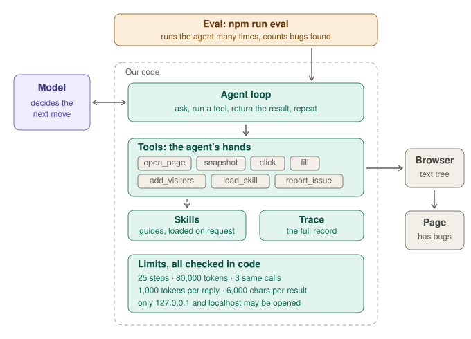

# qa-agent-mini

A tiny QA agent, built step by step to learn how agents are made.

## What the agent will do

The agent is a small AI tester. You give it a web page and a written specification (`SPEC.md`). It works like a QA engineer would:

1. It opens the page in a real browser.
2. It tries things: types a visitor's age, clicks "Add visitor", reads the price on the page.
3. It works out what the price should be according to the spec, and compares.
4. When the page does something different from the spec, it reports an issue with the steps, the expected result and the actual result.
5. When it has tested enough, it stops and writes a short summary.

The page is a ticket price calculator with four bugs planted on purpose. Because we know the bugs, we can measure the agent:
how many bugs it finds, how many false alarms it raises, and how many steps, tokens and euros a run costs.

The agent decides what to test next. Our code does everything else: it runs the browser, blocks unsafe actions,
enforces limits on steps and cost, and records what happened.

## The architecture in one picture



**In four sentences.** The model only decides the next move; it cannot touch the page itself. Our code (the loop) carries out each move with a tool, gives the result back, and repeats. Tools are the agent's hands, skills are guides it takes from a shelf only when it needs one, and the trace is the record of the whole run. Every limit is checked by our code, not requested in the prompt, so the model cannot talk its way past it.

The limits (the values are in `src/agent.ts` and `src/tools.ts`):

| Limit | Value | What happens when it is reached |
|---|---|---|
| Steps (calls to the model) | 25 | The run stops. In practice the agent often stops by itself before this (see step 11). |
| Token budget for a run (input + output) | 120,000 | The run stops. It is checked at the end of a round, after the tools of the last reply have run, so a run can end slightly over. |
| Length of one reply of the model | 1,000 tokens | A longer reply is cut off; the loop tells the model and goes on. |
| Length of one tool result | 6,000 characters | The rest is cut off, which saves tokens. |
| The same call, result and page again and again | 3 times | First one warning in the tool result, then the run stops if it repeats. |
| Web hosts the agent may open | `127.0.0.1` and `localhost` | Any other address is refused by the `open_page` tool. |

## See it run


*The LangGraph version of the agent in LangGraph Studio, at the end of a run with the fake model. Left: the graph, two nodes (`model` decides, `tools` acts) in a loop. Right: the state after every node, newest at the bottom: in step 5 the agent reports the wrong senior price, in step 6 it asks for no more tools, writes its summary and the run ends with `done`. How to open it: [step 20b](docs/STEPS.md#step-20b-the-graph-in-langgraph-studio).*

## Try it

```bash
npm install
npm test                                  # unit tests: a fake model and a fake browser, no API key
npm run target -- --bugs=all              # the demo page with its four bugs: find them by hand first
npm run loop                              # the agent loop with a fake model and a real browser (free)
export ANTHROPIC_API_KEY=...              # the next commands use a real model and cost money
npm run agent -- --bugs=all               # one run; add --engine=graph for the LangGraph version
npm run eval -- --bugs=all --runs=3       # several runs, scored against the planted bugs
LANGSMITH_TRACING=false npm run studio    # the LangGraph version in LangGraph Studio (fake model unless QA_AGENT_STUDIO_MODEL is set)
```

If Playwright cannot download its browser, set `QA_AGENT_BROWSER_PATH` to an installed Chrome.

## Why a custom agent, and not Playwright Test Agents?

Playwright ships ready-made agents (the planner, generator and healer set up with `npx playwright init-agents`).
They are a good choice when you want to get working tests quickly. We deliberately do not use them here.

The goal of this repo is to understand how an agent is built: the tools, the loop, the limits, the safety checks and the eval.
A ready-made agent hides those parts. By writing a small one ourselves, every part is visible, can be changed and can be measured.
This is a learning project, not a replacement for the Playwright agents.

**Where we are:** all steps (1 to 21) are done. The agent works end to end with a real model (Haiku by default, Sonnet with one environment variable), every change since step 5 was measured with the eval, and the agent loop exists twice: hand-written (`src/agent.ts`) and built with LangGraph (`src/graph-agent.ts`). With a real model both find the same bugs at the same cost (step 21).

## Results in short

Haiku, 3 to 6 runs per measurement, so only large differences count. The full table with a link to every measurement is at the top of [RESULTS.md](RESULTS.md).

- **What helped:** better hands for the agent (`add_visitors` found the 11th-ticket bug in 3 of 3 runs, before 0 of 3; trimming old snapshots saved about 15% of the tokens per step), fixes in the loop (the stuck guard, reply handling), and removing "You have a limited number of steps" from the prompt (step 16: no more early stops, 3.7 of 4 bugs instead of 3.3, for 36% more tokens).
- **What did not help, or made things worse:** a prompt that states the budget (the model stopped early), trimming the page inside old tool results (the model repeated its tests), a skill (no gain, about 11% more tokens per step), a higher token budget (the agent mostly stops by itself).
- **Planted bugs:** the fourth bug had to be independent of the others. The first try (9b) failed, the second (9c) worked.
- **Safety:** two hidden notes that asked the agent to do something (open a forbidden address) were not obeyed in 12 runs of Haiku and 6 of Sonnet. The host check in code has still not met a real attempt, so this is no proof of safety. The review found that the check covered only `open_page`; now the browser itself blocks every other host too.
- **Framework:** the same loop built with LangGraph (step 21) found the same bugs (3.5 of 4) at the same cost per step; its own loop adds about 1 ms to a step that waits about 2 s for the model.
- **Model:** the same agent on Sonnet found all four bugs in 6 of 6 runs (Haiku at that time: 3.3 of 4) and ended every run by itself. The model mattered more than any single prompt or tool change; after step 16 Haiku comes closer (3.7 of 4), at a higher token cost.

## Lessons so far

The short version of what the steps taught us. Each step has its section in [docs/STEPS.md](docs/STEPS.md) and its numbers in [RESULTS.md](RESULTS.md).

1. **Measure before you keep a change, and write your guess first.** One run proves little, so we repeat runs (3 to 6) and read the traces, not only the counts. Writing the guess before the runs shows how often we are wrong.
2. **A number in the prompt is read as a target** (step 6d). "You have about 14 steps" made the model stop at 9 to 13. Limits belong in code (steps 3 and 5); the prompt should not quote them. Step 16 showed it holds even without a number: removing "You have a limited number of steps" ended the early stops of Haiku and raised the bugs found from 3.3 to 3.7 of 4, for 36% more tokens.
3. **Do not cut the evidence the model cannot ask for again** (step 6f). A page that no longer exists after "Clear order" is the proof of a test. When we cut it, the model repeated its tests.
4. **A better tool beats a longer prompt** (step 6e). One tool that adds several visitors at once found the 11th-ticket bug in 3 of 3 runs (before 0 of 3). The prompt changes (6d, 9a) and the skill (8) brought much less.
5. **Not every addition gains something, and that is a result** (steps 8 and 9a). The skill was loaded in 6 of 6 runs and changed nothing; it only cost 11% more tokens.
6. **Seen is not noticed** (step 9a). When the group bug was reported late, the model had not waited: the wrong total was in the page earlier, but the model did not read it until later. A prompt line about reporting cannot fix that.
7. **A planted bug must be independent of the others** (step 9b). Our fourth bug was switched on by "Clear order", and the agent clicks that button at the start of almost every test to get a clean order. From then on every price on the page was a mix of two bugs, so the agent found the other bugs less often and the score gave points for the wrong reasons. Test: ask "does the agent do something all the time that switches this bug on?". If yes, it is not a good bug.
8. **One fixed canary is not a proof of safety** (step 6b). It shows the agent is not trivially hijacked. The real protection is in code: the allowed hosts and the limits. And a rule in code protects only the paths it is on: until the review the host check was only in `open_page`, so a click on a link could have left the allowed hosts (see "Fixes after a review").
9. **The model can matter more than the prompt and the tools** (step 12). After seven steps of changes to the prompt, the tools and the limits that moved Haiku by about a bug or less, the same agent on Sonnet found all four bugs in 6 of 6 runs and stopped when it was finished. It is one comparison with 6 runs per model, so it is a direction and not a number. It also means that the eval can no longer tell apart two versions that find 4 of 4: more changes would need harder bugs.
10. **A score can be gamed, so check the evidence too** (step 18). Our score reads report titles, and a fake agent that only writes the right words gets full marks ("specification gaming": the letter of the measure is met, its purpose is not). A check that compares each report with what the trace shows the agent really saw catches it. On real runs it found no invented report, only four quotes rewritten from memory.
11. **A framework changes how the agent is built, not what it finds** (steps 20 and 21). The same loop built with LangGraph found the same bugs with Haiku at the same cost per step. Its own loop costs 1 ms per step against 2 s for the model. What differs is what it brings (Studio, pausing, going back to an earlier step) and what it costs (a dependency, its own limit of 25 nodes, its own message format). So, build or buy? For a small agent with one loop and a few tools, like this one, we build it by hand: every part is visible and nothing happens that we did not write. We would take LangGraph when the agent needs what it brings ready-made: a person approving an action before it runs, resuming a long run after a crash, several agents in one graph, or one shape shared by a team. Either way, the limits and the safety checks stay in our own code ([docs/STEPS.md, step 21](docs/STEPS.md#hand-written-loop-or-langgraph)). And a fake model only produces the message shapes we thought of: a real cut-off reply found one that the round-trip test had missed.

## Steps

Every step is one small pull request, so the history reads like a tutorial. What each step built, why, and what the measurement showed: **[docs/STEPS.md](docs/STEPS.md)**. The numbers: [RESULTS.md](RESULTS.md).

- [x] **Step 1**: the thing to test
- [x] **Step 2**: the hands
- [x] **Step 3**: the brain and the loop
- [x] **Step 4**: the first real run
- [x] **Step 5**: guardrails
- [x] **Step 5a**: seeing and fixing what the runs showed
- [x] **Step 6**: eval
- [x] **Step 6c**: trimming old page snapshots
- [x] **Step 6d**: tried and not kept: a prompt that states the budget
- [x] **Step 6e**: a tool that adds several visitors in one call
- [x] **Step 6f**: tried and not kept: trimming the page inside old `add_visitors` results
- [x] **Step 6b**: prompt-injection canary
- [x] **Step 7**: CI
- [x] **Step 8**: skills for the agent
- [x] **Step 9a**: a prompt line: report a difference right after you see it
- [x] **Step 9b**: tried and not kept: a fourth planted bug, `clear-keeps-count`
- [x] **Step 9c**: a fourth planted bug that is independent of the others, `decimal-age-accepted`
- [x] **Step 10a**: an action canary (issue #37, idea 2)
- [x] **Step 10b**: a neutral action canary (issue #37)
- [x] **Step 11**: a higher token budget (80,000 to 120,000)
- [x] **Step 12**: the same agent on Sonnet
- [x] **Step 13**: wrap-up
- [x] **Step 14**: a page that shows one trace
- [x] **Step 15**: the trace page appears by itself
- [x] **Fixes after a review of the repo**
- [x] **Step 16**: no "limited number of steps" in the prompt
- [x] **Step 17**: latency and price in the eval summary
- [x] **Step 18**: an evidence check against specification gaming
- [x] **Step 19**: a temptation to game the score
- [x] **Step 20**: the same loop, built with LangGraph
- [x] **Step 20b**: the graph in LangGraph Studio
- [x] **Step 21**: hand-written loop or LangGraph? Measured

Rule for every step: run it, break it on purpose, and write down what you learned in the pull request.

## How the measurements were made

- **Every run with a real model** (`npm run agent`, `npm run eval`) was started by the author on her own computer, with her own Anthropic API key in the environment variable `ANTHROPIC_API_KEY`. The key was never written into a file, never sent to anyone, and is not in this repo (`test/secrets.test.ts` checks that).
- **The code was written with Claude (Claude Code)**, step by step, from the author's requests and with her approval of every design before it was built. Claude also read the traces she sent after each eval and wrote the analysis in `RESULTS.md`. Claude never had the key and never ran the model; the guesses in `RESULTS.md` were written before each measurement.
- **CI** (`.github/workflows/ci.yml`) has no key: it runs only the type check and the unit tests, which use a fake model and a fake browser.
- **What is committed:** only the summaries and the traces that `RESULTS.md` cites, in `results/`, after a check for secrets (API key, local paths, e-mail). The folders `runs/` and `evals/` stay on the author's computer.

## More

- [docs/STEPS.md](docs/STEPS.md): the roadmap and every step in detail.
- [docs/HOW-TO-READ.md](docs/HOW-TO-READ.md): the files of the repo in the order to read them.
- [RESULTS.md](RESULTS.md): every measurement, with the guess written before it.
- [docs/IDEAS.md](docs/IDEAS.md): what could come next (not planned).
